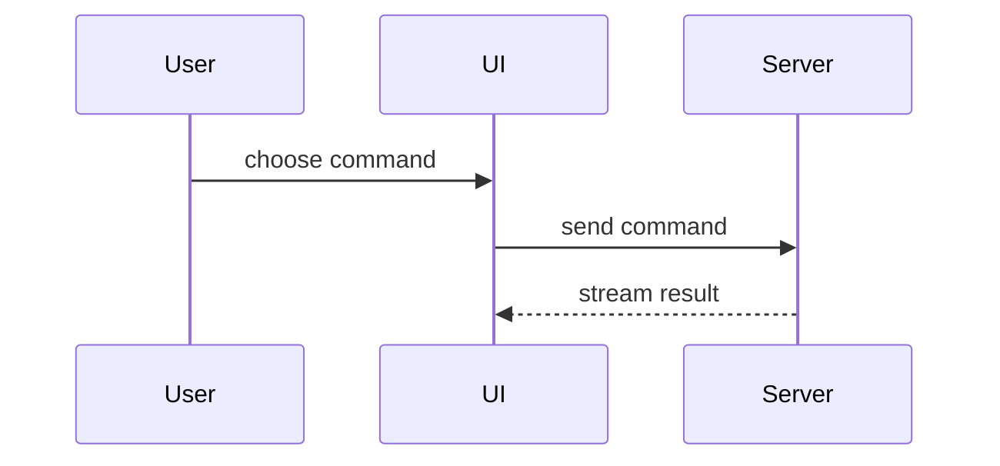

# PR body

`Needs you:` first, only when blocked, one line per item. In auto mode, the plan comes next. Then these `##` sections, in this order. Keep prose brief and in the repository's domain language; adapt the examples to the change.

## What Changed

Lead with user-visible behaviour, then what a reviewer needs. Add a visual only when it makes its text clearer, beside that text, with enough context for ownership, order, state, and module boundaries.

### Logic: pseudocode

```text
on(save)
  if content is unchanged
    return cached result
  write new content
  return fresh result
```

### Runtime flow: call tree

```text
submitForm
  createSession
    persistPrompt
    launchAgent
  navigateToSession
```

### UI structure: component tree

```text
<SessionPage> (src/routes/session.tsx)
  useSessionEvents()
  <SessionToolbar>
    <RunCommandButton> (packages/ui)
  <SessionTimeline>
```

### File responsibilities: shallow tree

```text
src/
├── commands/       # parses user actions
├── sessions/       # owns session state
└── transport/      # sends API requests
```

### Interactions or data flow: Mermaid



### Changes to an existing shape: diff sketch

A sketch, not a literal patch.

Component change:

```diff
 <SessionPage>
   <SessionToolbar>
+    <RunCommandButton />
   <SessionTimeline>
+    <CommandResultCard />
```

File-layout change:

```diff
 src/
 ├── commands/
+│   └── expand.ts       # expands the selected command
 ├── sessions/
-└── transport.ts
+└── transport/
+    ├── client.ts
+    └── stream.ts
```

Call-tree change:

```diff
 submitForm
   createSession
     persistPrompt
+    expandCommand
     launchAgent
   navigateToSession
+    subscribeToEvents
```

State or control-flow change:

```diff
 on(save)
-  write content
+  if content is unchanged
+    return cached result
+  write new content
+  invalidate cache
```

### Mostly new or copyable target: whole block

When the code is mostly new, its order matters, or a reader will copy it:

```ts
function expandCommand(command: string): string {
  const name = command.slice(1);
  return `run ${name}`;
}
```

### Decisions taken

Last in What Changed, omitted when empty: each default from the Mode table, and each choice a reviewer could question. One bullet each, a few words of reason.

```markdown
**Decisions taken:**

- Empty state reads "No notes yet" (recommended option).
- Cache stays in memory; a shared cache is out of scope.
```

## Why

One sentence: the problem and the outcome.

> Unchanged saves previously rewrote the file; returning the cached result avoids unnecessary writes.

## Evidence

Execution evidence first: for each state, the command, the revision, and short observed output. Pseudocode belongs in What Changed. These examples show the format, not results:

Regression — the same test on both revisions (the red-then-green test from Build):

````markdown
Command: `python3 -m unittest tests.test_save.SaveTests.test_unchanged_content`

**Before** (`<base SHA>`):
```text
FAIL: test_unchanged_content
AssertionError: expected 0 writes, got 1
```

**After** (`<published SHA>`):
```text
Ran 1 test
OK
```
````

New behaviour — no comparable before state:

````markdown
**Before:** No `--dry-run` option existed; no baseline execution captured.

**After** (`<published SHA>`), `app import sample.csv --dry-run`:
```text
3 records validated; 0 records written
```
````

Then, one line each when they apply:

- **Tier:** trivial, normal, or risky.
- **Full run:** its commit (in a stack, the top PR's run) and result; after a failure, each failed test with its fix; tests marked flaky.
- **Review:** `Cross-reviewed: <N> rounds with <model>. Verdict: <approved | open findings>`.
- **UI:** assets as `` ([EVIDENCE.md](EVIDENCE.md#github)), or "before not captured".
- `not verified: <what>`, one line per change you could not verify.

## References

Omit without a linked task. `ship-release` and ClickUp's GitHub link read the `- ClickUp:` line and its token. Mention other tasks on `- Related:` lines, without a token; `ship-release` skips them.

```markdown
- ClickUp: [<task name>](<task URL>)
<!-- #<task ID>[<statuses.roadmap.review>] -->
- Related: [<task name>](<task URL>)
```

## Merge Danger

Always:

- **Door:** `one-way` only for destructive or hard-to-reverse results, otherwise `two-way`. Judge the real rollback, persistent data and external effects included.
- **Blast Radius:** the shortest accurate domain label.

Below each, an optional one-sentence paragraph: the rollback action under Door; the material consequence or precaution under Blast Radius. Keep every material irreversible consequence. Then, one line each when they apply: `Base failure: <test>` (it also fails on the base; not fixed here) and `Open finding: <id> <claim>` (review budget ended).

Reversible behaviour change:

```markdown
**Door:** two-way

Revert to restore the previous save behavior.

**Blast Radius:** Session saves

Stale cache entries could return outdated content.
```

Destructive migration:

```markdown
**Door:** one-way

Reverting cannot recover dropped records; restoring requires a backup.

**Blast Radius:** Archived sessions

Affected accounts lose their archived session history.
```

## ClickUp summary

The `PR summary · <owner>/<repo>#<n>` comment, for readers who may not read code: plain domain words, no code, paths, or diagrams, one or two sentences per part.

- **Problem:** from Why.
- **Solution:** the user-visible change, from What Changed.
- **Conclusion:** the outcome now, the PR state (draft or ready), and the full-run result; name a `one-way` door with its consequence.

```markdown
**PR summary · acme/notes#42**

[fix(save): skip unchanged writes](https://github.com/acme/notes/pull/42)

**Problem:** Saving a note that had not changed rewrote the file every time.

**Solution:** Saves now detect unchanged content and return the cached result.

**Conclusion:** Unchanged saves no longer write to disk. The PR is ready for review and the full run passed.
```
